
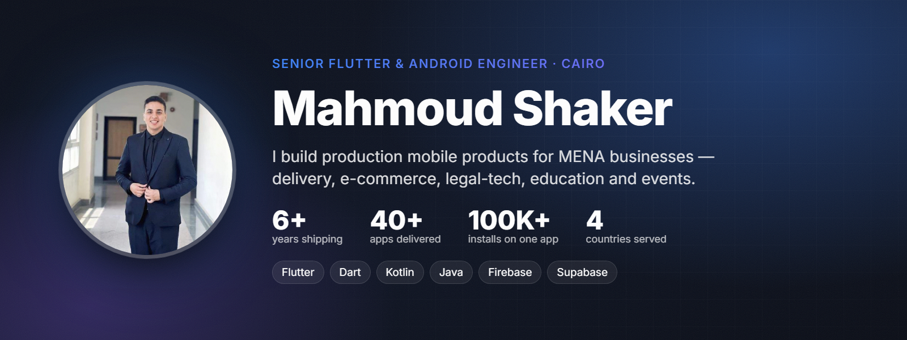

  
  
  
  

  

## 👋 About me

I'm **Mahmoud Shaker**, an application developer specialising in **Flutter** and **native Android (Java & Kotlin)** with **6+ years of professional experience**. I've worked part-time and full-time inside product companies and remotely with clients as a freelancer, delivering large, multi-app platforms end-to-end — and leading small teams to ship them on time and to a high bar. Currently **Tech Lead at 1Way World** (Saudi Arabia).

Today I build complete products for businesses across **Egypt, Saudi Arabia, Iraq and Palestine**: the customer app, the driver app, the merchant/restaurant app, the web app and the admin side. **40+ apps delivered** to Google Play and the App Store so far. I care about clean architecture, smooth Arabic-first UX, and code that keeps working after launch.

<table>
<tr>
<td width="33%" valign="top">

### 📱 Mobile
Flutter & Dart · native Android (Kotlin / Java) · Bloc / Cubit · Clean Architecture · GetX · Shorebird OTA · Arabic RTL

</td>
<td width="33%" valign="top">

### 🧩 Product
White-label platforms · realtime tracking · thermal POS printing · payments & wallets · offline sync · push & chat

</td>
<td width="33%" valign="top">

### 🔌 Backend & tools
Firebase · Supabase · REST APIs · Postman · push notifications · payments · Git & GitHub · Play Console & App Store Connect

</td>
</tr>
</table>

<b>🇪🇬 بالعربي</b>

 

أنا **محمود شاكر**، مطوّر تطبيقات متخصص في **Flutter** و**Android (Java & Kotlin)** بخبرة أكثر من **6 سنوات**. اشتغلت دوام جزئي وكامل في شركات، وعن بُعد مع عملاء كفريلانسر، وسلّمت مشاريع كبيرة متعددة التطبيقات وقُدت فرق صغيرة لتسليمها بكفاءة. وحالياً **Tech Lead في 1Way World** (السعودية).

حالياً أبني منتجات كاملة لعملاء في **مصر والسعودية والعراق وفلسطين**: تطبيق العميل والمندوب والمطعم/التاجر، وتطبيق الويب ولوحة التحكم — وسلّمت أكتر من **40 تطبيق** على Google Play وApp Store.

## 🚀 Projects

> Client work is shown with screens, architecture and engineering notes — the code stays with the client. Repos marked **Source code** include the full project.

<table>
<tr>
<td width="50%" valign="top"><a href="https://github.com/ANaSHaker/talabatek-case-study">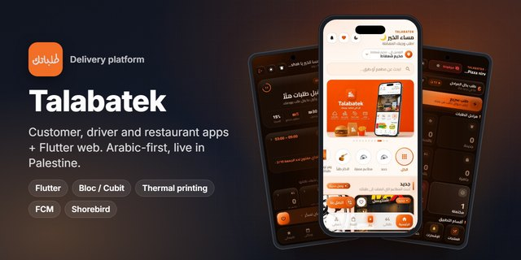</a> <b><a href="https://github.com/ANaSHaker/talabatek-case-study">Talabatek · طلباتك</a></b> · 🇵🇸 Palestine Delivery platform — customer, driver, restaurant & web  </td>
<td width="50%" valign="top"><a href="https://github.com/ANaSHaker/riza-ai-visual-search">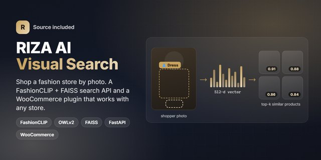</a> <b><a href="https://github.com/ANaSHaker/riza-ai-visual-search">RIZA · Fashion & Shopping</a></b> · 🇸🇦 Saudi Arabia Fashion store app + search-by-photo engine (source included)   </td>
</tr>
<tr>
<td width="50%" valign="top"><a href="https://github.com/ANaSHaker/vanilla-cosmetics">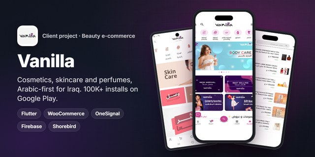</a> <b><a href="https://github.com/ANaSHaker/vanilla-cosmetics">Vanilla · ڤانيلا</a></b> · 🇮🇶 Iraq Cosmetics & beauty store — 100K+ installs on Google Play  </td>
<td width="50%" valign="top"><a href="https://github.com/ANaSHaker/sim-2022-case-study">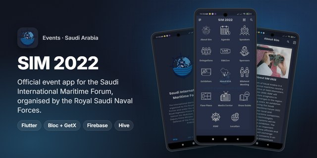</a> <b><a href="https://github.com/ANaSHaker/sim-2022-case-study">SIM 2022</a></b> · 🇸🇦 Saudi Arabia Official app of the Saudi International Maritime Forum </td>
</tr>
<tr>
<td width="50%" valign="top"> <b><a href="https://github.com/ANaSHaker/insurify-case-study">BFI Insurify</a></b> · 🇪🇬 Egypt Bilingual insurance app — compare, buy & track policies  </td>
<td width="50%" valign="top"><a href="https://github.com/ANaSHaker/delivery-iq-case-study">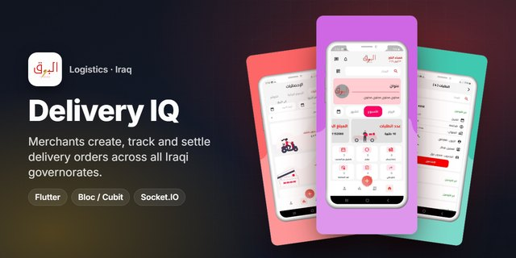</a> <b><a href="https://github.com/ANaSHaker/delivery-iq-case-study">Delivery IQ · Al Barq</a></b> · 🇮🇶 Iraq Merchant app for an Iraqi delivery company  </td>
</tr>
<tr>
<td width="50%" valign="top"><a href="https://github.com/ANaSHaker/gahez-case-study">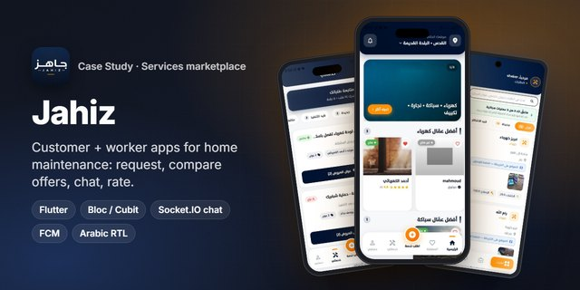</a> <b><a href="https://github.com/ANaSHaker/gahez-case-study">Jahiz · جاهز</a></b> · 🇵🇸 Palestine Home-services marketplace — request, compare offers, chat  </td>
<td width="50%" valign="top"> <b><a href="https://github.com/ANaSHaker/studygo-case-study">StudyGo</a></b> · 🇵🇸 Palestine Education platform for students, teachers & parents  </td>
</tr>
<tr>
<td width="50%" valign="top"><a href="https://github.com/ANaSHaker/oneway-case-study">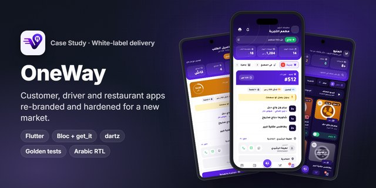</a> <b><a href="https://github.com/ANaSHaker/oneway-case-study">OneWay Fast Food</a></b> · 🇸🇦 Saudi Arabia Food delivery with live tracking & POS printing </td>
<td width="50%" valign="top"> <b><a href="https://github.com/ANaSHaker/hamilguide-case-study">HamilGuide · دليل الحمل</a></b> · 🇪🇬 Egypt Pregnancy tracker — 100K+ installs, 5 languages  </td>
</tr>
<tr>
<td width="50%" valign="top"> <b><a href="https://github.com/ANaSHaker/devora-ecommerce-suite">DevOra E-commerce Suite</a></b> · 🇮🇶 Iraq One white-label codebase → Aleefie, Deno Store, StarMart, Irtaah  </td>
<td width="50%" valign="top"><a href="https://github.com/ANaSHaker/legalpal-app-case-study">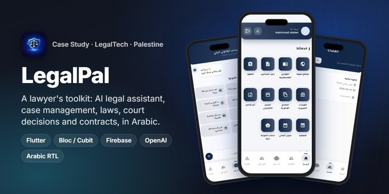</a> <b><a href="https://github.com/ANaSHaker/legalpal-app-case-study">LegalPal · App</a></b> · 🇵🇸 Palestine Legal platform for lawyers in Palestine  </td>
</tr>
<tr>
<td width="50%" valign="top"><a href="https://github.com/ANaSHaker/legalpal-web-case-study">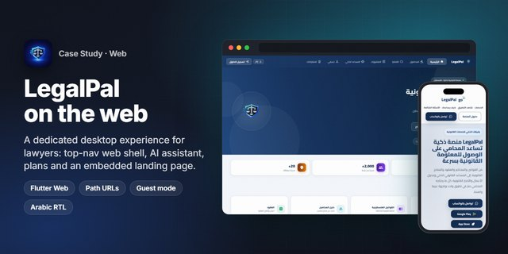</a> <b><a href="https://github.com/ANaSHaker/legalpal-web-case-study">LegalPal · Web</a></b> · 🇵🇸 Palestine Desktop-first Flutter web platform </td>
<td width="50%" valign="top"> <b><a href="https://github.com/ANaSHaker/mohami-plus-app-case-study">Mohami Plus · App</a></b> · 🇮🇶 Iraq Legal services app for Iraq — 18 legal services </td>
</tr>
<tr>
<td width="50%" valign="top"><a href="https://github.com/ANaSHaker/mohami-plus-web-case-study">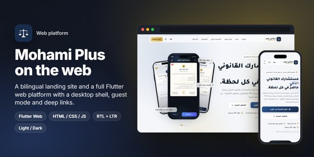</a> <b><a href="https://github.com/ANaSHaker/mohami-plus-web-case-study">Mohami Plus · Web</a></b> · 🇮🇶 Iraq Landing site + Flutter web platform </td>
<td width="50%" valign="top"><a href="https://github.com/ANaSHaker/midgram-case-study">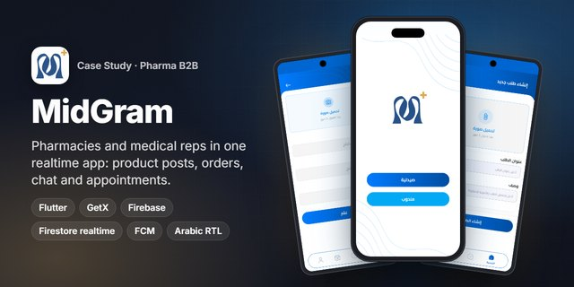</a> <b><a href="https://github.com/ANaSHaker/midgram-case-study">MidGram</a></b> · 🇮🇶 Iraq Pharmacies ↔ medical reps: products, orders & realtime chat </td>
</tr>
<tr>
<td width="50%" valign="top"><a href="https://github.com/ANaSHaker/riftech-case-study">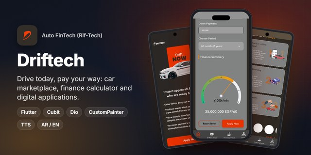</a> <b><a href="https://github.com/ANaSHaker/riftech-case-study">Driftech (Rif-Tech)</a></b> · 🇪🇬 Egypt Car financing with a live installment calculator & gauge </td>
<td width="50%" valign="top"> <b><a href="https://github.com/ANaSHaker/malazmna">Malazmna</a></b> · 🇮🇶 Iraq Education app for Iraqi students — books, past papers, results </td>
</tr>
<tr>
<td width="50%" valign="top"> <b><a href="https://github.com/ANaSHaker/vendora">Vendora</a></b> · 🇪🇬 Egypt Multi-tenant POS & commerce SaaS — desktop, mobile, web </td>
<td width="50%" valign="top"><a href="https://github.com/ANaSHaker/elmwafer">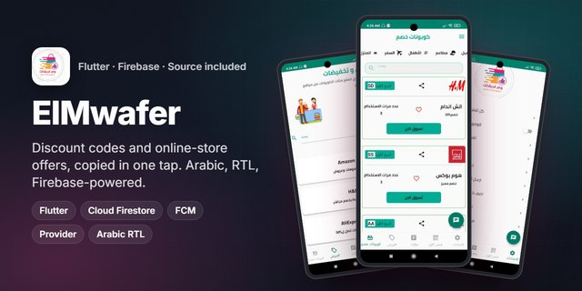</a> <b><a href="https://github.com/ANaSHaker/elmwafer">ElMwafer</a></b> · 🇸🇦 Saudi Arabia Offers & coupons marketplace </td>
</tr>
<tr>
<td width="50%" valign="top"> <b><a href="https://github.com/ANaSHaker/visit-egypt">Visit Egypt</a></b> · 🇪🇬 Egypt Bilingual tourism guide with maps, events & tools </td>
<td width="50%" valign="top"> <b><a href="https://github.com/ANaSHaker/muslim-app">Muslim</a></b> · 🇪🇬 Egypt Offline Quran, azkar, prayer times & Qibla </td>
</tr>
<tr>
<td width="50%" valign="top"><a href="https://github.com/ANaSHaker/sawah-case-study">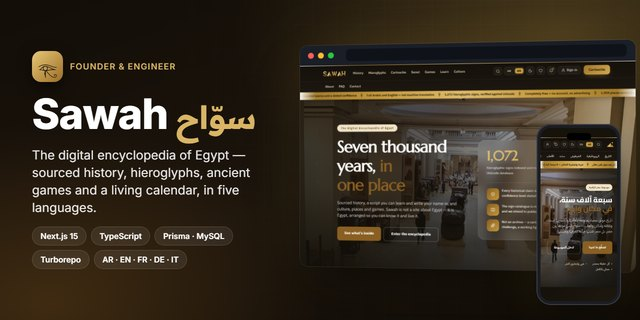</a> <b><a href="https://github.com/ANaSHaker/sawah-case-study">Sawah · سوّاح</a></b> · 🇪🇬 Egypt Digital encyclopedia of Egypt — hieroglyphs, calendar, games </td>
<td width="50%" valign="top"><a href="https://github.com/ANaSHaker/duat-case-study">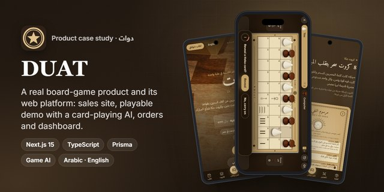</a> <b><a href="https://github.com/ANaSHaker/duat-case-study">DUAT</a></b> · 🇪🇬 Egypt My ancient-Egyptian board game </td>
</tr>
<tr>
<td width="50%" valign="top"> <b><a href="https://github.com/ANaSHaker/video_walkthrough">video_walkthrough</a></b> · 📦 pub.dev Flutter package: video-backed onboarding </td>
</tr>
</table>

## 🛠️ Tech stack

  

## 📦 Open source

- [**video_walkthrough**](https://github.com/ANaSHaker/video_walkthrough) — video-backed onboarding for Flutter, on [pub.dev](https://pub.dev/packages/video_walkthrough)
- [**riza-ai-visual-search**](https://github.com/ANaSHaker/riza-ai-visual-search) — search-by-photo for any WooCommerce store

---
<h3 align="center">Let's build something great together</h3>

  
  
  
  
  
  
  

